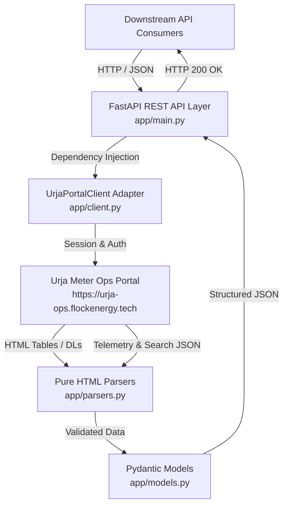

# Flock Energy - Urja Meter Ops REST API

A clean, modern, and production-grade REST API wrapper built on **FastAPI** that interfaces with the legacy **Urja Meter Ops** portal (`https://urja-ops.flockenergy.tech`).

This service automates authentication, maintains persistent session cookies, transparently auto-reauthenticates on session expiration, normalizes both HTML server-rendered structures and hidden internal telemetry JSON APIs, and exposes typed, validated REST endpoints with OpenAPI 3.0 specifications.

---

## Architecture Overview



---

## Features

- **Automated Session Management & Persistence**: Uses `httpx` persistent client to store and transmit session cookies (`__Secure-better-auth.session_token`).
- **Transparent Auto-Reauthentication**: Intercepts session expiration (HTTP 401 or redirect to `/login`) and re-authenticates on-the-fly without bubbling errors to callers.
- **Multi-Source Resilience**: Intelligently handles both server-rendered HTML pages (via BeautifulSoup4) and internal JSON endpoints (search, telemetry, signed export).
- **HMAC-SHA256 Signed Protocol Integration**: Integrates with the portal's internal HMAC-signed export system to fetch all 403 meters in a single high-performance request (<0.5s).
- **Strict Data Validation**: Pydantic schemas enforce type safety, parse messy date formats (e.g., `DD/MM/YYYY HH:MM`), and convert strings to native floats.
- **Interactive OpenAPI Documentation**: Auto-generated Swagger UI at `/docs`, ReDoc at `/redoc`, and exported schema at `openapi.json`.

---

## Getting Started

### Prerequisites

- Python 3.10+ (tested on Python 3.11, 3.12, 3.15)
- Git

### Installation

1. **Clone the repository**:
   ```bash
   git clone https://github.com/flock-energy/flock-energy-api.git
   cd flock-energy-api
   ```

2. **Create and activate a virtual environment**:
   ```bash
   # Windows (PowerShell)
   python -m venv .venv
   .\.venv\Scripts\Activate.ps1

   # Linux / macOS
   python3 -m venv .venv
   source .venv/bin/activate
   ```

3. **Install dependencies**:
   ```bash
   pip install -r requirements.txt
   ```

4. **Environment Configuration (Optional)**:
   Defaults match the assignment credentials, but can be overridden via `.env`:
   ```env
   PORTAL_BASE_URL=https://urja-ops.flockenergy.tech
   PORTAL_USERNAME=operator@urja.local
   PORTAL_PASSWORD=urja-ops-2026
   REQUEST_TIMEOUT=10.0
   ```

### Running the API Server

Start the API development server using `uvicorn`:

```bash
uvicorn app.main:app --host 127.0.0.1 --port 8000 --reload
```

The interactive documentation will be available at:
- **Swagger UI**: [http://127.0.0.1:8000/docs](http://127.0.0.1:8000/docs)
- **OpenAPI Schema**: [http://127.0.0.1:8000/openapi.json](http://127.0.0.1:8000/openapi.json)

---

## API Endpoints & Sample Curls

### 1. Health Check
```bash
curl -X GET http://127.0.0.1:8000/health
```
**Response (200 OK)**:
```json
{
  "status": "ok"
}
```

---

### 2. Explicit Authentication
*(Note: Authentication happens automatically behind the scenes for all endpoints, but explicit login is also provided)*
```bash
curl -X POST http://127.0.0.1:8000/api/v1/auth/login \
  -H "Content-Type: application/json" \
  -d '{"username": "operator@urja.local", "password": "urja-ops-2026"}'
```
**Response (200 OK)**:
```json
{
  "success": true,
  "message": "Authentication successful",
  "session_active": true
}
```

---

### 3. List Smart Meters
```bash
curl -X GET http://127.0.0.1:8000/api/v1/meters
```
**Response (200 OK)**:
```json
[
  {
    "meter_id": "J100000",
    "serial_number": "SE33962",
    "status": "Decommissioned",
    "location": "DT-001"
  },
  {
    "meter_id": "J100001",
    "serial_number": "GE84132",
    "status": "Installed",
    "location": "DT-002"
  }
]
```

---

### 4. Get Meter Details
```bash
curl -X GET http://127.0.0.1:8000/api/v1/meters/J100000
```
**Response (200 OK)**:
```json
{
  "meter_id": "J100000",
  "serial_number": "SE33962",
  "status": "Decommissioned",
  "location": "Malviya Nagar DT 1 (DT-001)",
  "install_date": null,
  "last_reading": 48580.79,
  "last_reading_at": "2026-06-30T23:30:00",
  "firmware_version": null,
  "customer": null
}
```

---

### 5. Get Consumption History
```bash
curl -X GET http://127.0.0.1:8000/api/v1/meters/J100000/consumption
```
**Response (200 OK)**:
```json
{
  "meter_id": "J100000",
  "readings": [
    {
      "timestamp": "2026-06-23T23:30:00",
      "kwh": 48438.74,
      "unit": "kWh"
    },
    {
      "timestamp": "2026-06-24T00:00:00",
      "kwh": 48439.16,
      "unit": "kWh"
    }
  ]
}
```

---

### 6. Get Network Hierarchy Tree (Extension)
```bash
curl -X GET http://127.0.0.1:8000/api/v1/hierarchy
```
**Response (200 OK)**:
```json
{
  "node_id": "root",
  "name": "Urja Distribution Network",
  "node_type": "root",
  "children": [
    {
      "node_id": "F-001",
      "name": "Feeder F-001",
      "node_type": "feeder",
      "children": [
        {
          "node_id": "DT-001",
          "name": "Malviya Nagar DT 1 (DT-001)",
          "node_type": "dt",
          "children": []
        }
      ]
    }
  ]
}
```

---

## Architectural Trade-offs

1. **Shared Persistent Client vs. Connection Pool**:
   - *Current Implementation*: A single `UrjaPortalClient` instance manages the portal connection and cookie jar.
   - *Trade-off*: Simplifies session reuse and state caching for single-process instances without needing external session stores like Redis. In high-concurrency multi-tenant scenarios, a pool of session instances keyed by tenant or operator would prevent session contention.

2. **Multi-Tier Fallback (HTML Scraping + Internal APIs)**:
   - *Trade-off*: When querying the legacy portal, the client first attempts to read standard HTML routes, falling back to internal APIs (`/portal/export`, `/portal/meters/search`, `/portal/meters/{id}/energy`) when the static HTML table is empty or routes are missing. This guarantees backward compatibility with both traditional mock servers and the dynamic live SvelteKit application.

3. **In-Memory Transformation vs. Caching**:
   - *Trade-off*: Data is fetched fresh from the legacy portal on each API invocation to ensure real-time accuracy. In production, a short TTL cache (e.g. 60 seconds) would reduce unnecessary load on the legacy portal.

---

## Intentional Omissions

- **Write Operations (PUT/DELETE/POST Meters)**: The legacy Urja portal is strictly an operational telemetry monitoring portal; mutation endpoints were neither present nor required.
- **Persistent Database**: As an API adapter/wrapper layer, state is ephemeral and lives directly on the upstream portal.
- **Client-Side Svelte Re-hosting**: We intentionally do not serve or recompile frontend SvelteKit assets; our responsibility is purely the clean REST API proxy.

---

## Running Automated Tests

The test suite covers API routes, client session management, auto-reauthentication, HTML and JSON parsers, and data validation models.

Run the entire test suite with `pytest`:

```bash
pytest -v
```

Output:
```
tests/test_api.py .................                                      [ 31%]
tests/test_client.py ..............                                      [ 57%]
tests/test_models.py ........                                            [ 72%]
tests/test_parsers.py ...............                                    [100%]

============================= 54 passed in 0.70s ==============================
```

To update or re-export the OpenAPI schema:
```bash
python export_openapi.py
```
